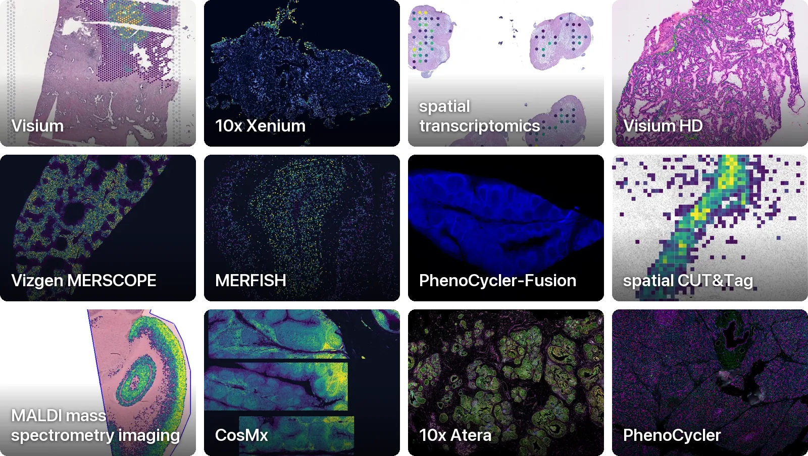

# spatialdata-db: spatial omics datasets as SpatialData

spatialdata-db is a catalog of public spatial omics datasets, from Visium and Xenium to MERSCOPE, CosMx and mass spectrometry imaging.
Each dataset is converted to a SpatialData Zarr store, described by one row of the catalog and registered in the Lamin instance [scverse/spatialdata-db](https://lamin.ai/scverse/spatialdata-db).
{{ catalog_line }} You can browse every dataset and collection on the [website]({{ site_url }}).

This Python client queries the catalog by technology, tissue, organism, gene or free text and loads the datasets you pick as `SpatialData` objects.
It builds cohorts of datasets that you can freeze, split by study and turn into training data, and it collects the citations of the studies they come from.
The `sddb-cli` command and the `sddb-mcp` server give the shell and AI agents the same queries and downloads.

```{raw} html
<figure class="sddb-mosaic">
  <picture>
    <source media="(max-width: 575.98px)" srcset="_static/landing-mosaic-narrow.webp" width="792" height="1826">
    
  </picture>
  <figcaption>The 12 largest technologies in the catalog, one dataset each.</figcaption>
</figure>
```

## Installation

::::{tab-set}

:::{tab-item} pip
```bash
pip install "spatialdata-db @ git+https://github.com/theislab/spatialdata-db-client@v0.1.2"
```
:::

:::{tab-item} uv
```bash
uv pip install "spatialdata-db @ git+https://github.com/theislab/spatialdata-db-client@v0.1.2"
```
:::

::::

This installs the alpha release, v0.1.2. The `main` branch may be ahead of it, and you get the newest code if you leave out `@v0.1.2`.

The client needs Python 3.12 or newer. It is not on PyPI yet, so install it from GitHub.

## Quick example

```python
from sddb import Catalog

hits = Catalog().query(technology="Visium", tissue="lung")
hits.summary()
smallest = min(hits, key=lambda ds: ds.size_bytes)
sdata = smallest.to_sdata()  # about 7 MB, copied to the local cache once
```

## Tutorials and reference

::::{grid} 1 2 2 3
:gutter: 3

:::{grid-item-card} {octicon}`globe;1.5em;sd-mr-1` From the website
:link: start
:link-type: doc

Load a dataset or collection you found on the website.
:::

:::{grid-item-card} {octicon}`book;1.5em;sd-mr-1` Tutorials
:link: tutorials/index
:link-type: doc

A numbered series from the first query to a frozen cohort with its citations.
:::

:::{grid-item-card} {octicon}`beaker;1.5em;sd-mr-1` Use cases
:link: use_cases/index
:link-type: doc

Longer analyses built on the client, such as an atlas of every Visium section.
:::

:::{grid-item-card} {octicon}`terminal;1.5em;sd-mr-1` CLI and agents
:link: guides/cli-and-agents
:link-type: doc

Query, download and cite from the shell or an AI agent.
:::

:::{grid-item-card} {octicon}`code-square;1.5em;sd-mr-1` API reference
:link: reference/api
:link-type: doc

Every public class and function, with its parameters.
:::

:::{grid-item-card} {octicon}`law;1.5em;sd-mr-1` Citations and licenses
:link: tutorials/04_citations_and_licences
:link-type: doc

Cite the studies behind your data and check what their licenses allow.
:::

::::

## Cite and license

A publication that describes the database is forthcoming.
Until then, cite the studies behind the data you use: `cohort.citations()` writes their BibTeX entries, and `sddb-cli cite` does the same from the shell.
Each dataset keeps the license of its source, and {doc}`tutorials/04_citations_and_licences` explains how to check and filter by license.

```{toctree}
:hidden:
:maxdepth: 2
:caption: Getting started

start
intro/assays
intro/db-stack
```

```{toctree}
:hidden:
:maxdepth: 2
:caption: Tutorials

tutorials/index
```

```{toctree}
:hidden:
:maxdepth: 2
:caption: Use cases

use_cases/index
```

```{toctree}
:hidden:
:maxdepth: 2
:caption: How-to

guides/cli-and-agents
```

```{toctree}
:hidden:
:maxdepth: 2
:caption: Reference

reference/api
reference/cli
reference/mcp
reference/catalog-columns
```

```{toctree}
:hidden:
:maxdepth: 1
:caption: Project

changelog
```
